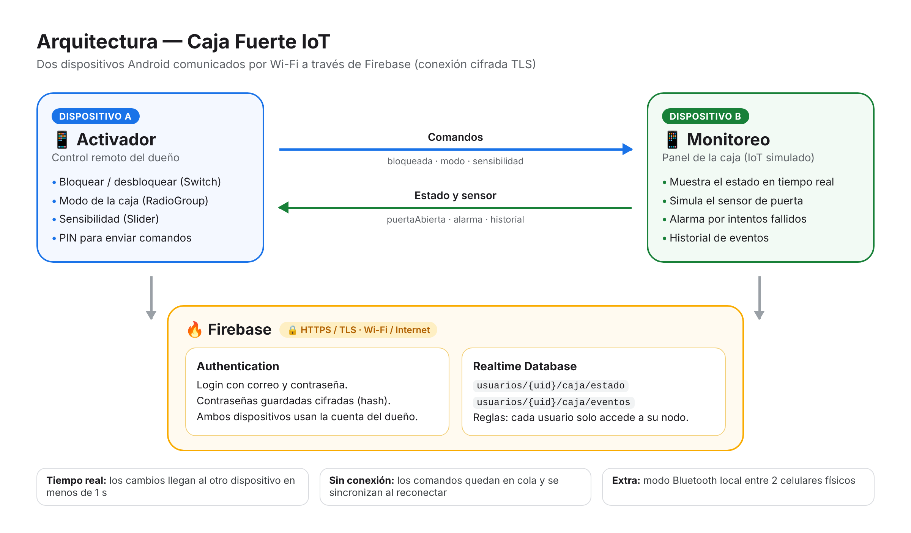
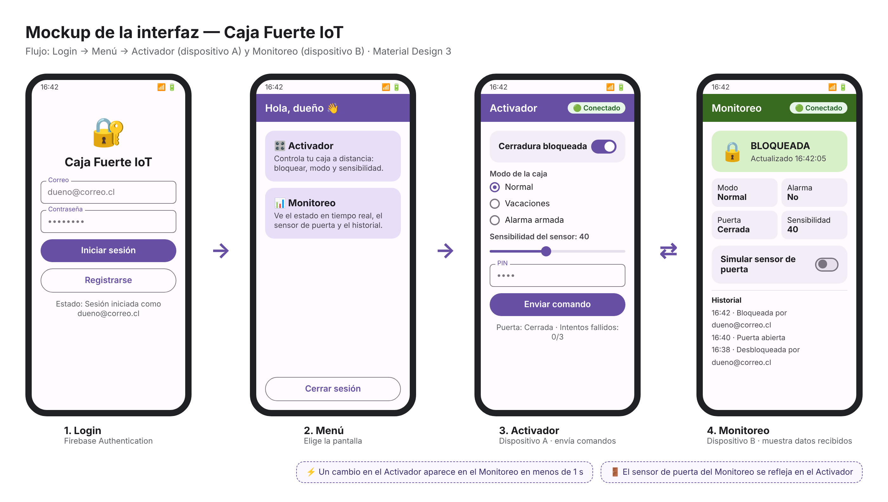

# 🔐 Caja Fuerte IoT — App Android de control y monitoreo

**Asignatura:** TI3042 Aplicaciones Móviles para IoT · INACAP Sede Puente Alto
**Unidad 2:** Aplicaciones Móviles Android
**Autor:** Benjamín Liberona
**Entrega:** Evaluación Sumativa 2 (ES2) — jueves 22 de octubre de 2026

---

## 1. Problemática

En la Unidad 1 trabajamos una **caja fuerte inteligente**. El problema que resuelve es que el dueño de una caja fuerte normalmente **no sabe qué pasa con ella cuando no está presente**:

- No sabe si quedó **bloqueada o abierta**.
- No se entera si alguien **intentó abrirla** con un PIN incorrecto.
- No puede **bloquearla o desbloquearla a distancia** (por ejemplo, para que un familiar saque algo).
- No tiene un **registro** de quién y cuándo se abrió.

**Solución:** una app Android que permite **monitorear** el estado de la caja y **activar** acciones sobre ella de forma inalámbrica, desde otro dispositivo. En esta unidad el dispositivo IoT (la caja) se **simula en un segundo dispositivo Android**, tal como indica la guía ("simulando funcionalidades de control y monitoreo de dispositivos IoT").

## 2. Funcionalidades

| # | Funcionalidad | Pantalla |
|---|---|---|
| F1 | Registro e inicio de sesión con correo y contraseña | Login |
| F2 | Bloquear / desbloquear la caja a distancia (Switch) | Activador |
| F3 | Cambiar el modo de la caja: Normal / Vacaciones / Alarma armada (RadioGroup) | Activador |
| F4 | Ajustar la sensibilidad del sensor de la puerta (Slider) | Activador |
| F5 | Exigir PIN para enviar cualquier comando (EditText) | Activador |
| F6 | Ver en tiempo real el estado recibido: cerradura, modo, puerta, alarma y última actualización | Monitoreo |
| F7 | Simular el sensor de puerta (abierta/cerrada), que se envía de vuelta al otro dispositivo | Monitoreo |
| F8 | Alarma automática tras 3 intentos de PIN fallidos | Activador → Monitoreo |
| F9 | Historial de eventos (quién, qué y cuándo) | Monitoreo |
| F10 | Indicador de conexión (🟢 Conectado / 🔴 Sin conexión) | Activador y Monitoreo |

## 3. Herramientas y justificación

| Herramienta | Uso | Por qué |
|---|---|---|
| **Android Studio + Kotlin** | Desarrollo de la app | Es el IDE y el lenguaje oficiales de Android, y los exige la asignatura. |
| **Views XML + Material Components** | Interfaz | Es el estándar de diseño de Android (Material Design), con componentes como `MaterialSwitch`, `Slider` y `TextInputLayout`. |
| **Firebase Authentication** | Login | Guarda las contraseñas cifradas (hash) en el servidor y no requiere montar un backend propio. Permite usar la misma cuenta en varios dispositivos. |
| **Firebase Realtime Database** | Datos e interconexión | Sincroniza los datos entre dispositivos **en tiempo real** (menos de 1 s), mantiene una caché sin conexión y se reconecta solo. Además guarda el historial para consultarlo. |
| **GitHub** | Control de versiones y entrega | Respaldo del código e historial de avances. |

**Alternativas descartadas:**
- **SQLite:** solo guarda datos en un dispositivo, así que no sirve para comunicar dos dispositivos. Además las contraseñas habría que cifrarlas manualmente.
- **API + MySQL:** exige programar, hospedar y asegurar un servidor propio, lo que es más complejo y tiene más puntos de falla para un proyecto individual.

## 4. Comunicación inalámbrica

**Tecnología elegida:** Wi-Fi / Internet, a través de Firebase Realtime Database (conexión cifrada con TLS).

| Criterio | Wi-Fi + Firebase | Bluetooth clásico (HC-06 / SPP) |
|---|---|---|
| **Distancia** | Ilimitada (cualquier lugar con internet) | ~10 metros |
| **Consumo** | Medio | Bajo |
| **Estabilidad** | Alta: reconexión automática y cola de comandos sin conexión | Media: se corta al alejarse |
| **Seguridad** | TLS + autenticación + reglas de acceso | PIN de emparejamiento |

**Por qué Wi-Fi:** el valor de la app es que el dueño controle su caja **cuando no está cerca**. El Bluetooth obligaría a estar a menos de 10 metros, lo que no resuelve el problema.
**Extra planificado:** un modo Bluetooth local entre dos celulares físicos (Sesión 8), como alternativa si no hay internet.

### Arquitectura



Los dos dispositivos inician sesión con la **cuenta del dueño**, así que comparten el mismo nodo de datos y nadie más puede acceder a él.

### Estructura de datos (Realtime Database)

```
usuarios/
  {uid}/
    caja/
      estado/
        bloqueada:      true
        modo:           "NORMAL" | "VACACIONES" | "ALARMA"
        sensibilidad:   0..100
        puertaAbierta:  false
        alarma:         false
        intentosFallidos: 0
        actualizado:    1729100000000
      eventos/
        {pushId}: { tipo: "DESBLOQUEADA", usuario: "correo@...", fecha: 1729100000000 }
```

## 5. Diseño de la interfaz (mockup)



**Flujo:** Login → Menú → Activador (en el dispositivo A) / Monitoreo (en el dispositivo B).
Un cambio en el Activador se ve en el Monitoreo en menos de 1 segundo, y el sensor de puerta del Monitoreo se refleja en el Activador.

## 6. Seguridad (ISO/IEC 27400 · lineamientos OT)

| Medida | Riesgo que mitiga | Referencia |
|---|---|---|
| Contraseñas cifradas (hash) por Firebase Authentication | Robo de credenciales | ISO/IEC 27400 — gestión de credenciales |
| Reglas de Realtime Database: cada usuario solo lee y escribe su propio nodo | Acceso no autorizado a los datos | ISO/IEC 27001 A.5.15 Control de acceso · IEC 62443 mínimo privilegio |
| Conexión cifrada HTTPS/TLS | Intercepción de datos en la red | ISO/IEC 27400 — protección de las comunicaciones |
| PIN obligatorio para enviar comandos | Uso del teléfono por terceros | Autenticación de doble paso para acciones críticas (OT) |
| Bloqueo y alarma tras 3 intentos fallidos | Ataques de fuerza bruta | IEC 62443 — limitación de intentos |
| Historial de eventos | Falta de trazabilidad | ISO/IEC 27001 A.8.15 Registro (logging) |
| Validación de los campos de entrada | Errores y datos inválidos | Buenas prácticas OWASP Mobile |
| Cierre de sesión | Sesión abierta en un dispositivo prestado | Control de acceso |

> ✅ **Verificación:** las medidas fueron comprobadas con evidencia (capturas en `evidencias/`), incluidas pruebas de ataque en el simulador de reglas de Firebase.
>
> 📄 Detalle completo de las 15 medidas, su ubicación en el código y su **verificación**: [`SEGURIDAD.md`](SEGURIDAD.md). Reglas de Firebase: [`firebase/database.rules.json`](firebase/database.rules.json).

## 7. Plan de pruebas (resumen)

| Grupo | Escenarios | Qué se verifica |
|---|---|---|
| Interconexión | P1–P4 | Login en ambos dispositivos, comando A→B, sensor B→A, guardado y consulta del historial |
| Estabilidad | P5–P14 | Sin internet y reconexión, segundo plano, rotación, comandos rápidos, PIN incorrecto, alarma, forzamiento, acceso sin sesión, reinicio |
| Eficiencia | — | Listeners en tiempo real, liberación en `onStop()`, escrituras mínimas, historial limitado |
| Unitarias | 7 pruebas | Reglas de `Seguridad.kt` |

> ✅ **Resultado: 14/14 escenarios aprobados**, 7/7 pruebas unitarias y 1 error encontrado y corregido durante las pruebas. La versión final se re-probó entre **2 celulares físicos** (Motorola moto g5 · Android 14 y HONOR ALT-NX3 · Android 15). Evidencias en la carpeta [`evidencias/`](evidencias/).
>
> 📄 Plan completo de 14 escenarios con su registro de resultados: [`PRUEBAS.md`](PRUEBAS.md). Pruebas unitarias automáticas: `app/src/test/.../SeguridadTest.kt`.

## 8. Estructura del proyecto

```
CajaFuerteIoT/
├── app/src/main/java/com/benjamin/cajafuerteiot/
│   ├── CajaApp.kt            → Inicio de la app: activa la caché sin conexión de Firebase
│   ├── LoginActivity.kt      → Pantalla Login: registrarUsuario() e iniciarSesion() (Firebase Auth, Sesión 9)
│   ├── MenuActivity.kt       → Menú: Activador, Monitoreo y cerrar sesión
│   ├── ActivadorActivity.kt  → Pantalla Activador: ENVÍA comandos (switch, radio, slider, PIN) y lee el estado
│   ├── MonitoreoActivity.kt  → Pantalla Monitoreo: MUESTRA datos recibidos + sensor de puerta + historial
│   └── Seguridad.kt          → Funciones que retornan un resultado: validaciones, hash del PIN, alarma, forzamiento
├── app/src/main/res/layout/  → Diseño de las 4 pantallas (XML + Material Design)
├── app/src/test/.../SeguridadTest.kt → Pruebas unitarias
├── firebase/database.rules.json      → Reglas de seguridad de la base de datos
├── SEGURIDAD.md                      → Medidas de seguridad y su verificación (ISO / OT)
└── PRUEBAS.md                        → Pruebas de interconexión y estabilidad
```

**Decisiones de diseño del código** (misma estructura vista en clases, Sesiones 6 a 9):
- **Cada pantalla es una Activity con su propio código:** `lateinit var` de las vistas, `findViewById` en `onCreate()`, `auth = Firebase.auth` y `database = Firebase.database.reference`, y funciones con nombres claros (`leerEstado()`, `guardarComando()`, `registrarEvento()`...).
- **Firebase en tiempo real:** cada pantalla usa `addValueEventListener(object : ValueEventListener {...})` sobre `usuarios/{uid}/caja`, igual que `leerDatos()` en la Sesión 9.
- **Ciclo de vida (Sesión 7):** los listeners se registran en `onStart()` y se quitan en `onStop()`.
- **Seguridad aparte y probada:** las reglas de seguridad están en `Seguridad.kt`, como funciones que retornan un valor (igual que `evaluarTemperatura()` de la Sesión 6), con pruebas unitarias.
- **Manejo de errores:** cada escritura tiene `addOnFailureListener`, cada lectura tiene `onCancelled`, y el usuario siempre recibe un `Toast` claro.

## 9. Cómo ejecutar

1. **Firebase Console** (console.firebase.google.com):
   - Crear el proyecto y agregar una app Android con el paquete **`com.benjamin.cajafuerteiot`**.
   - Descargar `google-services.json` y copiarlo en la carpeta `app/`. No se sube al repositorio, por seguridad.
   - Activar *Authentication → Correo electrónico/contraseña*.
   - Crear *Realtime Database* y publicar las reglas de `firebase/database.rules.json`.
2. Abrir el proyecto en **Android Studio**, presionar **Sync Now** y luego ▶ **Run** en dos dispositivos Android (celulares físicos conectados por USB con depuración activada, o un emulador con Google Play).
3. Registrar una cuenta e iniciar sesión con la **misma cuenta** en ambos dispositivos.
4. Abrir **Activador** en uno y **Monitoreo** en el otro. La primera vez, el PIN que se escriba en el Activador queda configurado como PIN de la caja.

## 10. Tecnologías

Kotlin · Android Studio · Views XML + Material Components 1.12 · Firebase Authentication · Firebase Realtime Database · JUnit 4 · minSdk 24 / targetSdk 34
